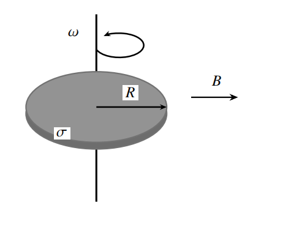

# 第四次作业

## 第8章

> **3.** A magnetic field $B$ along the $+z$ axis is present in the $y \geq a$ region of the $xy$-plane. If we put a circular loop of radius $R$ $(0 \leq a < R)$ and current $I$ (counterclockwise seen from $+z$) in the $xy$ plane with its center located at the origin, what would the total force be on the loop?

Total force

$$
\begin{aligned}
\vec F&=\int_{\mathop{AB}\limits^{\frown}}Id\vec l\times\vec B\\
&=I\vec{AB}\times\vec B\\
&=2IB\sqrt{R^2-a^2}\hat y
\end{aligned}
$$

> **4.** A plastic disk is rotating with angular velocity $\omega$ in a uniform magnetic field $B$ that is perpendicular to the disk's rotating axis (Figure 8.4). The disk has radius $R$, and it has a uniform surface charge density $\sigma$. Compute the magnitude of the total torque exerted by the magnetic field on the disk.

$$
\begin{aligned}
\tau&=\iint \vec r\times (dq\vec v\times\vec B)\\
&=\iint \vec r\times dq\cdot \omega r\cdot B\sin(\pi-\theta)\hat z\\
&=\iint(r\cos\theta\hat y-r\sin\theta\hat x)\times\sigma dS\cdot B\omega r\sin\theta\hat z\\
&=B\sigma\omega\hat y\int_0^Rdr\int_0^{2\pi}d\theta r^3(\cos\theta\sin\theta\hat x+\sin^2\theta\hat y)\\
&=\dfrac\pi4B\sigma\omega R^4\hat y
\end{aligned}
$$

> **7.** Uniform fields $\mathbf{E} = E\hat{x}$ and $\mathbf{B} = B\hat{z}$, with $E > 0$ and $B > 0$, fill all of space. At $t = 0$ a particle of mass $m$ and charge $q\neq 0$ is released from rest at the origin; $q$ may be of either sign. Ignore gravity.
>
> (a) Find the average velocity of the particle over one cyclotron period $T = 2\pi m / (|q|B)$ and show that it is the same for every $q$ and every $m$.
>
> (b) Find the largest value of $|x|$ that the particle reaches, and state for which sign of $q$ it moves toward $+x$.

Drift velocity:

$\vec v_d=\dfrac{\vec E\times\vec B}{B^2}=-\dfrac{E}{B}\hat y$

Transfer to frame $S'$ moving at $\vec v_d$ wrt $S$, the lab frame.

$\vec E'=\vec E+\vec v_d\times B=0$

So in frame $S'$, tha particle starts with $v_0=-v_d=\dfrac{E}{B}\hat y$, and experiences only the magnetic force. So it undergoes uniform circular motion.

(a)

In a period, the velocity of the uniform circular motion calcels each other, leaving the drift velocity $v_d$.

So $\bar v=\vec v_d=-\dfrac{E}{B}\hat y$, which is independent of $q,m$.

(b)

For the circular motion, $R=\dfrac{mv_0}{B|q|}$, and $|x|_{max}=2R=\dfrac{2mv_0}{B|q|}=\dfrac{2mE}{B^2|q|}$.

If $q>0$, the particle stays in $x>0$.

## 第9章

> **2.** A sphere with radius $R$ has a uniform charge distribution on its surface, carrying a total charge $Q$. The center of the sphere is at the origin, and the sphere is rotating around the $z$ axis with angular velocity $\omega$ in a counterclockwise fashion, as seen from the positive $z$ axis. Calculate the magnitude of the magnetic field at point $(0,0,z)$ for both $|z|< R$ and $|z| > R$.

> **7.** Two long straight wires cross the plane of the page at right angles, at the points $A$ and $B$. The wire through $A$ carries a current $i_{1}$ out of the page, and the wire through $B$ carries a current $i_{2}$ into the page, with $i_{1} > 0$ and $i_{2} > 0$. Evaluate $\oint \mathbf{B} \cdot d\mathbf{l}$ along each of the following closed paths, both of which lie in the plane of the page.
>
> (a) A path that goes around $A$ twice, counterclockwise as seen by the reader, without going around $B$.
>
> (b) A figure-eight path whose two loops lie side by side and meet at a single point, where the path crosses itself rather than merely touching itself: one loop goes around $A$ counterclockwise as seen by the reader, and the other goes around $B$.

> **9.** An ideal toroidal coil of $N$ turns carries a steady current $I$. Its tube has a circular cross section of radius $a$, whose center runs around a circle of radius $R$ $(R > a)$ in the $xy$ plane, centered at the origin. The coil is wound so that the magnetic field inside the tube circulates counterclockwise as seen from the positive $z$ axis. A thin, straight test wire is threaded through the winding along the $x$ axis, from $x = R - a$ to $x = R + a$, and carries a current $i$ in the $+x$ direction. Neglect the field produced by the test wire itself.
>
> (a) Find the magnetic force on this segment of wire (not on its leads).
>
> (b) Let $B_{0}$ be the magnitude of the field on the central circle of the tube. Show that the magnitude of the force is larger than $2aiB_{0}$, the force that a uniform field of magnitude $B_{0}$ would exert.