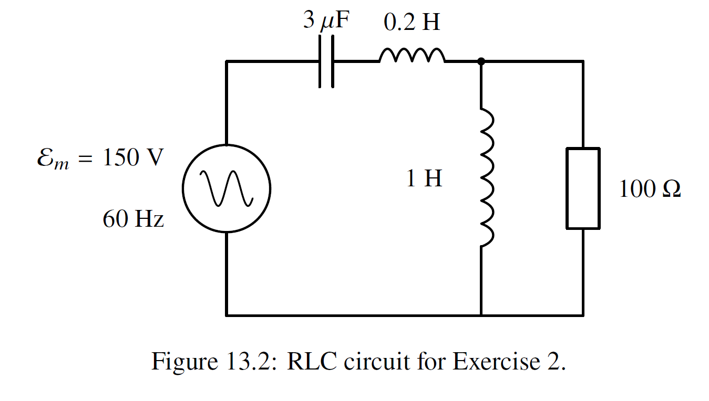

# 第六次作业

## Chapter 12

> **5.** A long, closely wound air-core solenoid of length $\ell$, cross-sectional area $S$ and $n$ turns per unit length has its axis along $z$ and negligible resistance; neglect end effects. Its terminals are $A$ and $B$, and its current is counted positive when it enters at $A$, leaves at $B$, and circulates counterclockwise as seen from $+z$. An ideal current source makes the current $i(t) = I_0(1 - 2t / T)$ for $0 \leq t \leq T$, where $I_0 > 0$ and $T > 0$, so that the current reverses from $+I_0$ to $-I_0$. Let $L$ be the solenoid's self-inductance.
>
> (a) Find the self-induced emf $\mathcal{E}_{L}$, counted positive along the winding in the positive sense, and the potential difference $V_{A} - V_{B}$. Which terminal is at the higher potential, and does this change when the current passes through zero?
>
> (b) Find the magnetic energy stored in the solenoid at $t = 0$, $T / 2$ and $T$, and the work done by the source on the solenoid during $0 \leq t \leq T / 2$ and during $T / 2 \leq t \leq T$.

(a)

$\mathcal{E}_L=-L\dfrac{di}{dt}=\dfrac{2LI_0}{T}$

$V_A-V_B=-\mathcal{E}=-\dfrac{2LI_0}{T}$

B is higher, which does not change.

(b)

$U_B=\dfrac12\mu_0 n^2lSi^2$

So $U_B(0)=\dfrac12\mu_0n^2lSI_0^2,U_B(T/2)=0,U_B(T)=\dfrac12\mu_0n^2lSI_0^2$

$W_1=U_B(T/2)-U_B(0)=-\dfrac12\mu_0n^2lSI_0^2$

$W_2=U_B(T)-U_B(T/2)=\dfrac12\mu_0n^2lSI_0^2$

> **7.** A long coaxial cable, with its axis along $z$, consists of a solid inner conductor of radius $a$, which carries a current $I > 0$ along $+z$, spread uniformly over its cross section, and a thin coaxial cylindrical shell of radius $b > a$, which carries the same current back, spread uniformly round it. Both conductors are nonmagnetic, so the energy density $B^{2} / 2\mu_{0}$ holds at every point, inside the metal as well as between the conductors. Consider a length $l$ of the cable and neglect end effects.
>
> (a) Find the magnitude and direction of the magnetic field at a distance $r$ from the axis, for $r< a$, $a< r< b$ and $r > b$, and the magnetic energy stored in the length $l$ inside the inner conductor and between the conductors.
>
> (b) Using $U_{B} = \frac{1}{2} LI^{2}$, find the self-inductance $L$ of the length $l$.
>
> (c) A student instead computes the magnetic flux through a flat rectangle of length $l$ that lies in a plane containing the axis and extends from the axis to $r = b$, and divides it by $I$. Find the result, and explain why it is not the self-inductance.

(a)

By Ampere's Law

$r<a$, $2\pi rB=\mu_0\dfrac{\pi r^2}{\pi a^2}I$, so $B=\dfrac{\mu_0Ir}{2\pi a^2}\hat\phi$

$a<r<b$, $2\pi rB=\mu_0I$, so $B=\dfrac{\mu_0I}{2\pi r}\hat\phi$

$r>b$, $2\pi rB=0$, so $B=0$

$U_{B,in}=\iiint\dfrac{B^2}{2\mu_0}dV=\dfrac{\mu_0lI^2}{16\pi}$

$U_{B,bet}=\iiint\dfrac{B^2}{2\mu_0}dV=\int_0^ldz\int_0^{2\pi}d\theta\int_a^b\dfrac{B^2}{2\mu_0}rdr=\dfrac{\mu_0lI^2}{4\pi}\ln\dfrac ba$

(b)

$L=\dfrac{2U_B}{I^2}=2\dfrac{U_{B,in}+U_{B,bet}}{I^2}=\dfrac{\mu_0l}{8\pi}(1+4\ln\dfrac ba)$

(c)

$$
\begin{aligned}
\Phi&=\int_0^blB(r)dr\\
&=l[\int_0^a\dfrac{\mu_0Ir}{2\pi a^2}dr+\int_a^b\dfrac{\mu_0I}{2\pi r}dr]\\
&=\dfrac{\mu_0Il}{4\pi}(1+2\ln\dfrac ba)
\end{aligned}
$$

So $\dfrac{\Phi}{I}=\dfrac{\mu_0l}{4\pi}(1+2\ln\dfrac ba)$, which is not the same as (b).

Because the $\Phi$ should be the megnetic flux through the region bounded by the actual circuit. But what we calculate in (c) is not this region, and the cable cannot form a closed circuit even.

> **9.** Two fixed, long, thin-wound solenoids share the $z$ axis and have the same length $\ell$. The inner one has radius $a$ and $n_{1}$ turns per unit length; the outer one has radius $b > a$ and $n_{2}$ turns per unit length. Neglect end effects and the resistance of the windings, and take the space inside and around them to be vacuum. A current $i_{1}$ or $i_{2}$ is counted positive when it produces a field along $+z$. Ideal sources can change either current slowly while holding the other fixed.
>
> (a) Find the self-inductances $L_{1}$ and $L_{2}$ and the mutual inductances $M_{12}$ and $M_{21}$.
>
> (b) The currents are brought from zero to final values $I_{1} > 0$ and $I_{2} > 0$ in two ways: first $i_{1}$ to $I_{1}$ and then $i_{2}$ to $I_{2}$, or first $i_{2}$ to $I_{2}$ and then $i_{1}$ to $I_{1}$. Find the total work done by the two sources in each case, including the work of the source that holds its current fixed while the other changes.
>
> (c) Find the final magnetic energy by integrating $B^{2} / 2\mu_{0}$ over the regions $r < a$ and $a < r < b$, and compare it with your answer to (b).

(a)

$L_1=\mu_0n_1^2l(\pi a^2)=\pi\mu_0ln_1^2a^2$

$L_2=\pi\mu_0ln_2^2b^2$

$M_{12}=\dfrac{ln_1\Phi_{12}}{i_2}=\dfrac{\pi a^2\mu_0i_2ln_1n_2}{i_2}=\pi\mu_0n_1n_2la^2$

$M_{21}=\dfrac{ln_2\Phi_{21}}{i_1}=\dfrac{\pi a^2\mu_0i_1ln_1n_2}{i_1}=\pi\mu_0n_1n_2la^2$

(b)

$$
\mathcal{E_1}=-L_1\dfrac{di_1}{dt}-M_{12}\dfrac{di_2}{dt}\\
\mathcal{E_2}=-L_2\dfrac{di_2}{dt}-M_{21}\dfrac{di_1}{dt}\\
$$

So $P=-(\mathcal{E_1}i_1+\mathcal{E_2}i_2)=\dfrac{d}{dt}(\dfrac12L_1i_1^2+\dfrac12L_2i_2^2+M_{12}i_1i_2)$

So $W=L_1I_1+L_2I_2+M_{12}I_1I_2=\dfrac{\mu_0l\pi}2(n_1^2a^2I_1^2+n_2^2b^2I_2^2+2n_1n_2a^2I_1I_2)$

(c)

$$
\begin{aligned}
E&=\int_0^a\dfrac{B^2(r)}{2\mu_0}2\pi lrdr+\int_a^b\dfrac{B^2(r)}{2\mu_0}2\pi lrdr\\
&=\int_0^a\mu_0(n_1^2I_1^2+n_2^2I_2^2+2n_1n_2I_1I_2)\pi lrdr+\int_a^b\mu_0n_2^2I_2^2\pi lrdr\\
&=\dfrac{\mu_0l\pi}{2}(n_1^2a^2I_1^2+n_2^2b^2I_2^2+2n_1n_2a^2I_1I_2)
\end{aligned}
$$

which is the same as (b).

## Chapter 13

> **2.** In the steady state, calculate the amplitude of the current through the resistor in the RLC circuit of Figure 13.2.

$\omega=2\pi f\approx376.99rad/s$

$\tilde Z_C=\dfrac1{i\omega C}\approx-884.20i\Omega$

$\tilde Z_{L_1}=i\omega L_1\approx376.99i\Omega,\tilde Z_{L_2}=i\omega L_2\approx75.40i\Omega$

$\tilde Z_R=R=100\Omega$

$\tilde Z_{par}=\dfrac{Z_RZ_{L_1}}{Z_R+Z_{L_1}}\approx93.4+24.8i\Omega$

$Z_{tot}=Z_C+Z_{L_2}+Z_{par}\approx93.4-784.0i\Omega$

$|Z_{tot}|\approx789.8\Omega$

$I_{tot}=\dfrac{\mathcal{E}}{|Z_{tot}|}\approx0.190A$

$|V_{par}|=I_{tot}|Z_{tot}|\approx18.4V$

$I_R=\dfrac{|V_{par}|}{R}\approx0.184A$

> **4.** Two identical $RLC$ circuits, each with inductance $L$, capacitance $C$ and resistance $R$, are coupled through a mutual inductance $M$ (Section 12.5). Assume $|M|< L$, and count each charge and current positive in the senses for which $M > 0$.
>
> (a) Assume that the capacitor in one of the circuits carries charge $q_{1}$ and the capacitor in the other circuit carries charge $q_{2}$. Write down the coupled differential equations for charges $q_{1}$ and $q_{2}$.
>
> (b) Introduce normal coordinates $q_{+} \equiv q_{1} + q_{2}$ and $q_{-} \equiv q_{1} - q_{2}$, show that the differential equations decouple into two independent damped oscillators.
>
> (c) Setting $R = 0$, show that the normal mode frequencies are
>
> $$
> \omega_{+} = \frac{1}{\sqrt{(L + M)C}},\quad \omega_{-} = \frac{1}{\sqrt{(L - M)C}},
> $$
>
> so that the symmetric mode $q_{+}$ is the slower of the two, its effective inductance being $L + M$.

(a)

$\Phi_1=Li_1+Mi_2,\Phi_2=Mi_1+Li_2$

$$
\begin{cases}
\dfrac{q_1}{C}+R\dfrac{dq_1}{dt}+L\dfrac{d^2q_1}{dt^2}+M\dfrac{d^2q_2}{dt^2}=0\\
\dfrac{q_2}{C}+R\dfrac{dq_2}{dt}+M\dfrac{d^2q_1}{dt^2}+L\dfrac{d^2q_2}{dt^2}=0
\end{cases}
$$

(b)

Adding them together and do Eq1 minus Eq2 yield

$$
\begin{cases}
\dfrac{q_+}{C}+R\dfrac{dq_+}{dt}+(L+M)\dfrac{d^2q_+}{dt^2}=0\\
\dfrac{q_-}{C}+R\dfrac{dq_-}{dt}+(L-M)\dfrac{d^2q_-}{dt^2}=0\\
\end{cases}
$$

(c)

$R=0$ yields

$$
\begin{cases}
q_++C(L+M)\dfrac{d^2q_+}{dt^2}=0\\
q_-+C(L-M)\dfrac{d^2q_-}{dt^2}=0
\end{cases}
$$

So $\omega_+=\dfrac1{\sqrt{C(L+M)}},\omega_-=\dfrac1{\sqrt{C(L-M)}}$, $\omega_+<\omega_-$, $L_{eff,+}=L+M$

> **5.** An ideal battery of emf $\mathcal{E} > 0$, a resistor $r > 0$ and a switch are connected in series between two points $A$ and $B$, with the battery's positive terminal on the side of $A$. An ideal inductor $L$ (no resistance) is also connected between $A$ and $B$, and so is a capacitor $C$. The switch has been closed for a long time, and it is opened at $t = 0$; after that the inductor and the capacitor form a closed $LC$ circuit. Let $i_{L}$ be the current in the inductor, counted positive from $A$ to $B$ through the inductor, and $q$ the charge on the plate of the capacitor that is joined to $A$.
>
> (a) Just before $t = 0$ find $i_{L}$, $q$ and $V_{A} - V_{B}$.
>
> (b) For $t > 0$ find $q(t)$, $i_{L}(t)$ and $V_{A} - V_{B}$. Write $q(t)$ in the form $q = Q\cos (\omega_{0}t + \phi)$ of Section 13.1, with $Q > 0$ and give $Q$, $\omega_{0}$ and $\phi$.
>
> (c) Find the largest value of $|V_{A} - V_{B}|$ for $t > 0$, the first time at which it is reached, and which of $A$ and $B$ is then at the higher potential. Evaluate the voltage, and its ratio to $\mathcal{E}$ for $\mathcal{E} = 12\mathrm{V}$, $r = 6.0\Omega$, $L = 0.20\mathrm{H}$ and $C = 0.50\mu \mathrm{F}$, and check it by energy conservation.

(a)

Before $t=0$ in the stable state, the inductor acts as a wire, so the capacitor is short-circuited.

So $i_L=\dfrac{\mathcal{E}}{r},q=0,V_A-V_B=0$

(b)

$$
L\dfrac{d^2q}{dt^2}+\dfrac{q}{C}=0
$$

So $q=Q\cos(\omega_0t+\varphi)$, where $\omega_0=\dfrac{1}{\sqrt{LC}}$ and $q(0)=0,q'(0)=-\dfrac{\mathcal{E}}{r}$

So $\omega_0=\dfrac1{\sqrt{LC}},\varphi=\dfrac{\pi}2,Q=\dfrac{\mathcal{E}}{r}\sqrt{LC}$

(c)

$V_{max}=|V_A-V_B|_{max}=|\dfrac{q}{C}|_{max}=\dfrac{Q}{C}=\dfrac{\mathcal{E}}{r}\sqrt{\dfrac{L}{C}}$

The first time is $\omega_0t_0+\varphi=\pi$, so $t_0=\dfrac\pi2\sqrt{LC}$, and $q<0$, so B is higher.

$V_{max}\approx 1.26\times10^3V$

$\dfrac{V_{max}}{\mathcal{E}}\approx105$

Initial energy: $\dfrac12Li^2\approx0.4J$

When $V=V_{max}$, energy: $\dfrac12CV_{max}^2\approx0.4J$

So energy is reserved.