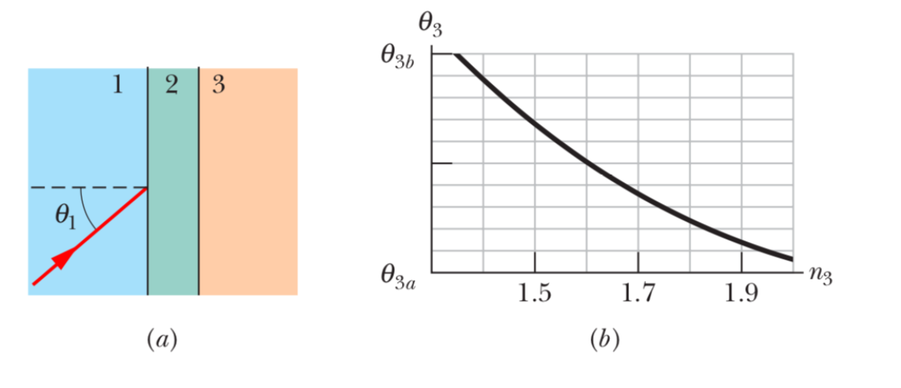
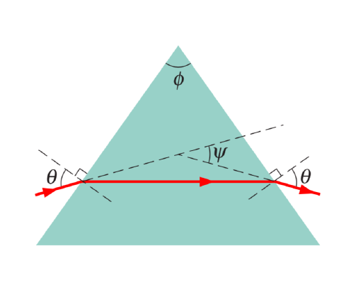
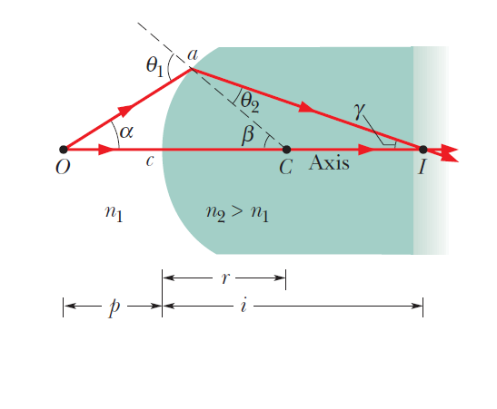

# General Physics II
# Homework #8

> **P8-1.** A plane electromagnetic wave traveling in the positive direction of an $x$ axis in vacuum has components $E_x = E_y = 0$ and $E_z = (2.0\ \text{V/m}) \cos[(\pi \times 10^{15}\ \text{s}^{-1})(t - x/c)]$.
>
> (a) What is the amplitude of the magnetic field component?
>
> (b) Parallel to which axis does the magnetic field oscillate?
>
> (c) When the electric field component is in the positive direction of the $z$ axis at a certain point P, what is the direction of the magnetic field component there?

(a)

$$
|B|=\dfrac{|E|}{c}\approx6.7\times10^{-9}T
$$

(b)

$\vec B=\dfrac1c(\hat k\times\vec E)$, so its oscillation direction is $\hat y$

(c)

When $\vec E=E\hat z(E>0)$, then $\vec B=\dfrac1c(\hat k\times\vec E)$, so its direction is $-\hat y$

> **P8-2.** A beam of light in material 1 is incident on a boundary at an angle $\theta_1 = 40^\circ$. Some of the light travels through material 2, and then some of it emerges into material 3. The two boundaries between the three materials are parallel. The final direction of the beam depends, in part, on the index of refraction $n_3$ of the third material.
>
> 
>
> Figure b gives the angle of refraction $\theta_3$ in that material versus $n_3$ for a range of possible $n_3$ values. The vertical axis scale is set by $\theta_{3a} = 30.0^\circ$ and $\theta_{3b} = 50.0^\circ$.
>
> (a) What is the index of refraction of material 1, or is the index impossible to calculate without more information?
>
> (b) What is the index of refraction of material 2, or is the index impossible to calculate without more information?
>
> (c) If $\theta_1$ is changed to $70^\circ$ and the index of refraction of material 3 is $2.4$, what is $\theta_3$?

(a)

From Figure b we obtain when $n_3=1.6,\theta_3=40.0^{\circ}$.

$$
\dfrac{\sin\theta_1}{\sin\theta_2}=\dfrac{n_2}{n_1}\\
\dfrac{\sin\theta_2}{\sin\theta_3}=\dfrac{n_3}{n_2}\\
$$

When $\theta_3=\theta_1$, we obtain $n_1=n_3=1.6$

(b)

No. Because we don't know anything about $\theta_2$. And you can replace material 2 without changing the curve.

(c)

From (a) we obtain $\dfrac{\sin\theta_1}{\sin\theta_3}=\dfrac{n_3}{n_1}$

So $\sin\theta_3=\dfrac{n_1}{n_3}\sin\theta_1\approx0.6265$, so $\theta_3\approx39^{\circ}$

> **P8-3.** A ray is incident on one face of a triangular glass prism in air. The angle of incidence $\theta$ is chosen so that the emerging ray also makes the same angle $\theta$ with the normal to the other face. Show that the index of refraction $n$ of the glass prism is given by
>
> $$
> n = \frac{\sin \frac{1}{2}(\psi + \phi)}{\sin \frac{1}{2}\phi}
> $$
>
> where $\phi$ is the vertex angle of the prism and $\psi$ is the deviation angle, the total angle through which the beam is turned in passing through the prism. (Under these conditions the deviation angle $\psi$ has the smallest possible value, which is called the angle of minimum deviation.)
>
> 

$$
\begin{cases}
2(\theta-\alpha)=\psi\\
2(\dfrac\pi2-\alpha)+\phi=\pi
\end{cases}
$$

So $\alpha=\dfrac\phi2,\theta=\dfrac{\phi+\psi}2$

$n=\dfrac{\sin\theta}{\sin\alpha}=\dfrac{\sin\frac12(\psi+\phi)}{\sin\frac12\phi}$

> **P8-4.** Consider images formed by refraction through spherical surfaces of transparent materials, such as glass. As shown in the figure, light emits from a point object O in a medium with index of refraction $n_1$. It will refract through a spherical surface of radius $r$ and center of curvature C into a medium of index of refraction $n_2$.
>
> Show that, for light rays making only small angles with the central axis, the object distance $p$ and the image distance $i$ are related by
>
> $$
> \frac{n_1}{p} + \frac{n_2}{i} = \frac{n_2 - n_1}{r}
> $$
>
> 

$$
\alpha\approx\tan\alpha\approx\dfrac hp\\
\beta\approx\tan\beta\approx\dfrac hr\\
\gamma\approx\tan\gamma\approx\dfrac hi\\
$$

$$
n_1\sin\theta_1=n_2\sin\theta_2
$$

So

$$
n_1(\alpha+\beta)=n_2(\beta-\gamma)
$$

So $\dfrac{n_1}{p}+\dfrac{n_2}{i}=\dfrac{n_2-n_1}{\gamma}$

> **P8-5.** When a thin lens with index of refraction $n$ is surrounded by some medium with index of refraction $n_{medium}$, show that the focal length $f$ is given by
>
> $$
> \frac{1}{f} = \left( \frac{n}{n_{medium}} - 1 \right) \left( \frac{1}{r_1} - \frac{1}{r_2} \right),
> $$
>
> where $r_1$ is the radius of curvature of the lens surface nearer the object and $r_2$ is that of the other surface.

$$
\dfrac{n_{medium}}{p_1}+\dfrac{n}{i_1}=\dfrac{n-n_{medium}}{r_1}\\
\dfrac{n}{p_2}+\dfrac{n_{medium}}{i_2}=-\dfrac{n-n_{medium}}{r_2}\\
$$

And $p_2=-i_1$, adding the two formula together yields

$$
\dfrac1{p_1}+\dfrac1{i_2}=\dfrac{n-n_{medium}}{n_{medium}}(\dfrac1{r_1}-\dfrac1{r_2})
$$

When $p_1=+\infty$, $f=i_2$, so $\dfrac1f=(\dfrac n{n_{medium}}-1)(\dfrac1{r_1}-\dfrac1{r_2})$

